# 📘 STEP 1 — Requirement Analysis & Project Foundation

### Library Management System · Stage 1 (ASP.NET Core MVC) · .NET 10 LTS

> [!NOTE]
> **How to read this guide.** It uses GitHub-style colored callouts, so it looks best on **GitHub** or in any Markdown viewer that supports GitHub alerts and Mermaid diagrams.

---

## 🎨 Color & Symbol Legend

| Symbol / Box | Meaning |
|---|---|
| > [!NOTE] 🔵 **Blue box** | Background info: good to know |
| > [!TIP] 🟢 **Green box** | Best practice / shortcut |
| > [!IMPORTANT] 🟣 **Purple box** | **Must remember**: core concept |
| > [!WARNING] 🟡 **Yellow box** | Common mistake / trap |
| > [!CAUTION] 🔴 **Red box** | Security or data-loss risk |
| 🔥 **MOST USED** | Things you will use every single day |
| 🎯 **INTERVIEW** | Frequently asked in interviews |
| ✍️ **TYPE IT** | Type this code by hand. **Do not copy-paste.** |
| 🖱️ **GUI** | Visual Studio / Windows steps |
| ⌨️ **CLI** | Command-line steps (`dotnet`, `git`, `winget`) |
| 🤔 **PREDICT** | Guess the result *before* running it |

In `diff` blocks, 🟢 `+` lines are **good / added** and 🔴 `-` lines are **bad / removed**.

> [!IMPORTANT]
> **The "no copy-paste" rule.** Every code block marked ✍️ must be **typed by you**. Typing forces your brain to read each keyword. When you get a compile error from a typo, **fix it yourself first.** That is how debugging skill is built.

---

## 🗺️ What Step 1 Covers

```mermaid
flowchart LR
    A[1. How engineers think] --> B[2. Requirement analysis]
    B --> C[3. Business rules & workflows]
    C --> D[4. Technical decisions]
    D --> E[5. Install tools]
    E --> F[6. Create solution<br/>GUI + CLI]
    F --> G[7. Understand project<br/>structure & Program.cs]
    G --> H[8. First real code:<br/>config + DI]
    H --> I[9. Run, debug, Git]
    I --> J[10. Interview prep<br/>+ Exercise]
```

**By the end of Step 1 you will have:**

- ✅ A written requirements document for the Library Management System (LMS)
- ✅ Roles, permissions, business rules, workflows and edge cases
- ✅ A first draft of the database design (ER diagram)
- ✅ .NET 10 SDK, Visual Studio 2026, SQL Server 2025 and SSMS 22 installed
- ✅ A running ASP.NET Core MVC solution, created **both** with the GUI and with the CLI
- ✅ A clear understanding of `Program.cs`, middleware, routing and `appsettings.json`
- ✅ Your first piece of real code: library settings read from configuration through Dependency Injection
- ✅ The project committed to Git

---

# PART 1 — How a Professional Engineer Thinks Before Coding

### 1.1 What are we doing?

We are **not** writing code yet. We are deciding **what** to build, **for whom**, and **under which rules**.

### 1.2 Why is this needed?

> [!CAUTION]
> Most failed software projects fail because of **unclear requirements**, not bad code. If you start coding a "Book Issue" screen without knowing *"How many books can a member borrow?"*, you will rewrite it three times.

**Cost of fixing a mistake grows with time:**

| Found during… | Relative cost to fix |
|---|---|
| Requirements | 💲 |
| Design | 💲💲 |
| Coding | 💲💲💲 |
| Testing | 💲💲💲💲 |
| Production | 💲💲💲💲💲💲💲💲 |

### 1.3 The Software Development Life Cycle (SDLC) in simple words

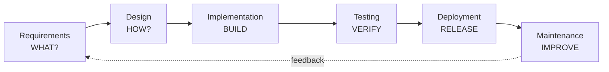

In real companies (Agile/Scrum), this cycle repeats in short **sprints** (1–2 weeks). Each sprint delivers a small working feature. We will work the same way: **one module at a time**.

### 1.4 The 5 questions a senior engineer always asks

1. 👤 **Who** will use the system? → *Roles*
2. 🎯 **What** must they be able to do? → *Functional requirements*
3. 📏 **How well** must it work? → *Non-functional requirements*
4. 📜 **Which rules** must never be broken? → *Business rules*
5. 💥 **What can go wrong?** → *Edge cases*

> [!TIP]
> 🎯 **INTERVIEW:** When an interviewer gives you a design question like *"Design a library system"*, **do not start with tables or classes.** Start by asking these 5 questions. That alone makes you sound senior.

---

# PART 2 — Requirement Analysis

## 2.1 Project Scope & Objectives

**Project name:** Library Management System (LMS)

**Objective:** Digitize a single library's daily operations: managing the book catalogue, members, issuing and returning books, tracking overdue books, and calculating fines.

| ✅ In Scope (Stage 1) | ❌ Out of Scope (for now) |
|---|---|
| One library branch | Multiple branches |
| Physical books | E-books, audio books |
| Issue, return, due dates, fines | Online payment gateway |
| Admin, Librarian, Member roles | Public guest browsing without login |
| Dashboard & basic reports | Advanced analytics / BI |
| English UI | Multi-language UI |
| Email/password login | Social login (Google, Microsoft) |
| | Book reservations / holds *(possible future feature)* |
| | Book renewals *(possible future feature)* |

> [!IMPORTANT]
> **Writing "Out of Scope" is as important as "In Scope".** It protects the project from *scope creep*, where features keep getting added until the project never finishes.

---

## 2.2 User Roles

| Role | Who is it? | Main goal |
|---|---|---|
| 👑 **Administrator** | IT/system owner | Manage users, roles, system settings, full reports |
| 📚 **Librarian** | Library staff | Manage catalogue and members, issue and return books, collect fines |
| 🙋 **Member** | Library customer | Search books, view own loans, due dates and fines |

## 2.3 Permission Matrix 🔥🎯

✅ = Allowed · ❌ = Not allowed · 👁️ = View only · 🔒 = Own records only

| Feature | 👑 Admin | 📚 Librarian | 🙋 Member |
|---|:---:|:---:|:---:|
| Login / Logout | ✅ | ✅ | ✅ |
| Register self as Member | — | — | ✅ |
| Manage users & assign roles | ✅ | ❌ | ❌ |
| Manage categories, authors, publishers | ✅ | ✅ | ❌ |
| Add / edit books | ✅ | ✅ | ❌ |
| Delete books | ✅ | ❌ | ❌ |
| Manage inventory (copies) | ✅ | ✅ | ❌ |
| Search & view books | ✅ | ✅ | ✅ |
| Manage members | ✅ | ✅ | ❌ |
| Issue a book | ✅ | ✅ | ❌ |
| Return a book | ✅ | ✅ | ❌ |
| View all loans / overdue list | ✅ | ✅ | ❌ |
| View own loans & due dates | — | — | 🔒 |
| Record fine payment | ✅ | ✅ | ❌ |
| Waive a fine | ✅ | ❌ | ❌ |
| View own fines | — | — | 🔒 |
| Dashboard | ✅ full | ✅ operational | 🔒 personal |
| Reports | ✅ | 👁️ | ❌ |

> [!WARNING]
> **Why can't a Librarian delete books or waive fines?** These are **destructive or financial** actions. Limiting them to the Admin follows the **Principle of Least Privilege**: give each user only the permissions they need for their job.

---

## 2.4 Functional Requirements (FR)

A **functional requirement** describes **what the system does**.

| ID | Module | Requirement |
|---|---|---|
| FR-01 | Authentication | Users can register (Members only), log in and log out |
| FR-02 | User management | Admin can create, edit, lock and unlock users |
| FR-03 | Role management | Admin can assign Administrator, Librarian or Member roles |
| FR-04 | Categories | Create, view, edit and delete book categories (e.g., *Science*, *Fiction*) |
| FR-05 | Authors | Create, view, edit and delete authors |
| FR-06 | Publishers | Create, view, edit and delete publishers |
| FR-07 | Books | Create, view, edit and delete books (title, ISBN, year, category, publisher, authors) |
| FR-08 | Inventory | Track total copies and available copies per book |
| FR-09 | Search | Search books by title, ISBN, author or category, with sorting and pagination |
| FR-10 | Issue | Librarian issues an available book to an eligible member |
| FR-11 | Return | Librarian records the return of an issued book |
| FR-12 | Due dates | System calculates the due date automatically when a book is issued |
| FR-13 | Overdue | System lists all issued books whose due date has passed |
| FR-14 | Fines | System calculates the fine automatically on a late return |
| FR-15 | Members | Librarian can manage member profiles (name, phone, membership status) |
| FR-16 | Dashboard | Show totals: books, members, issued, overdue, unpaid fines |
| FR-17 | Reports | Issued-books report, overdue report, fines-collected report |

## 2.5 Non-Functional Requirements (NFR) 🎯

A **non-functional requirement** describes **how well** the system works.

| ID | Category | Requirement |
|---|---|---|
| NFR-01 | 🔐 Security | Passwords are hashed (never stored as plain text); HTTPS only |
| NFR-02 | 🔐 Security | Every page checks the user's role on the **server** |
| NFR-03 | ⚡ Performance | Book search returns results in under 2 seconds for 100,000 books |
| NFR-04 | 📱 Usability | Responsive UI that works on desktop, tablet and mobile |
| NFR-05 | 🧱 Reliability | No book can be issued beyond its available copies, even with simultaneous requests |
| NFR-06 | 🧾 Auditability | Issue, return and fine actions record who did them and when |
| NFR-07 | 🛠️ Maintainability | Clean, consistent code structure; business rules are configurable, not hard-coded |
| NFR-08 | 📋 Logging | Errors are logged with enough detail to debug, without leaking sensitive data |
| NFR-09 | ♿ Accessibility | Forms have labels; colors are not the only way information is shown |

> [!TIP]
> 🎯 **INTERVIEW trick for remembering FR vs NFR:**
> **FR = verbs** (*"The system **issues** a book"*).
> **NFR = adjectives** (*"The system is **fast**, **secure**, **reliable**"*).

---

## 2.6 User Stories & Acceptance Criteria 🔥🎯

**User story format:**

> **As a** *&lt;role&gt;*, **I want** *&lt;goal&gt;*, **so that** *&lt;benefit&gt;*.

**Acceptance criteria format (Given–When–Then):**

> **Given** *&lt;starting situation&gt;* **When** *&lt;action&gt;* **Then** *&lt;expected result&gt;*.

### 📗 US-01: Issue a book

**As a** Librarian, **I want** to issue a book to a member, **so that** the library knows who has the book and when it is due.

| # | Given | When | Then |
|---|---|---|---|
| AC-1 | A member with 0 active loans and a book with 2 available copies | I issue the book | The loan is saved, available copies become **1**, due date = today + 14 days |
| AC-2 | A book with **0** available copies | I try to issue it | I see *"No copies available"*; nothing is saved |
| AC-3 | A member who already has **3** active loans | I try to issue another book | I see *"Issue limit reached (3)"*; nothing is saved |
| AC-4 | A member who already has this same book issued | I try to issue it again | I see *"Member already has this book"* |
| AC-5 | A member with unpaid fines above the limit | I try to issue | I see *"Member has unpaid fines"* |
| AC-6 | A member whose membership is inactive or expired | I try to issue | I see *"Membership is not active"* |

### 📘 US-02: Return a book

**As a** Librarian, **I want** to record a book return, **so that** the copy becomes available again and any fine is calculated.

| # | Given | When | Then |
|---|---|---|---|
| AC-1 | An active loan returned **on or before** the due date | I record the return | Return date saved, available copies +1, **no fine** |
| AC-2 | An active loan returned **5 days late** | I record the return | Fine = 5 × fine-per-day is created with status **Unpaid** |
| AC-3 | A loan that is **already returned** | I try to return it again | I see *"This book has already been returned"*; nothing changes |

### 📙 US-03: Search books

**As a** Member, **I want** to search books by title or author, **so that** I can find out whether a book is available.

| # | Given | When | Then |
|---|---|---|---|
| AC-1 | Books exist | I search "harry" | All books whose title or author contains "harry" are shown (case-insensitive) |
| AC-2 | More than 10 results | I view results | Results are paginated, 10 per page |
| AC-3 | No matching books | I search | I see a friendly empty state: *"No books found"* |

### 📕 US-04: View my loans

**As a** Member, **I want** to see my current loans and due dates, **so that** I return books on time and avoid fines.

| # | Given | When | Then |
|---|---|---|---|
| AC-1 | I am logged in as a Member | I open "My Loans" | I see **only my** loans, never other members' loans |
| AC-2 | One of my loans is overdue | I open "My Loans" | That loan is highlighted in red with the days overdue |

> [!IMPORTANT]
> **Acceptance criteria become test cases later.** Every AC row above will become an **xUnit test** in the Testing module. This is how requirements connect directly to code quality.

---

## 2.7 Business Rules 🔥🎯

Business rules are **rules of the business that the software must enforce**, no matter which screen or API is used.

| ID | Rule | Default value | Configurable? |
|---|---|---|:---:|
| BR-01 | Maximum active loans per member | **3** | ✅ |
| BR-02 | Loan period | **14 days** | ✅ |
| BR-03 | Fine per overdue day | **1.00** (currency) | ✅ |
| BR-04 | Maximum fine per loan (cap) | **50.00** | ✅ |
| BR-05 | A member cannot borrow when unpaid fines exceed | **10.00** | ✅ |
| BR-06 | A book can be issued only if available copies > 0 | — | ❌ |
| BR-07 | A member cannot hold two copies of the same book at the same time | — | ❌ |
| BR-08 | A loan can be returned only once | — | ❌ |
| BR-09 | Only active members can borrow | — | ❌ |
| BR-10 | ISBN must be unique | — | ❌ |
| BR-11 | A category, author or publisher used by books cannot be deleted | — | ❌ |
| BR-12 | A book with active loans cannot be deleted | — | ❌ |
| BR-13 | Available copies can never be negative or greater than total copies | — | ❌ |
| BR-14 | Fine days = return date − due date (calendar days, minimum 0) | — | ❌ |

> [!TIP]
> **Why make BR-01 to BR-05 configurable?** Libraries change policy, for example from "3 books" to "5 books". If the number is hard-coded in 10 places, you must edit code and redeploy. If it is in `appsettings.json`, you change **one value**. You will implement this in **Part 8** of this step.

**Fine calculation example (BR-03, BR-04, BR-14):**

```text
Due date      : 10 March
Returned on   : 15 March
Days overdue  : 15 − 10 = 5
Fine          : 5 × 1.00 = 5.00          (below the 50.00 cap → keep 5.00)

Returned 70 days late:
Fine          : 70 × 1.00 = 70.00 → capped to 50.00
```

---

## 2.8 Assumptions & Constraints

| Type | Item |
|---|---|
| 📌 Assumption | Each member has exactly one login account |
| 📌 Assumption | All dates are stored in **UTC** and displayed in the library's local time |
| 📌 Assumption | Fines are paid in cash at the desk; the system only records the payment |
| 📌 Assumption | Weekends and holidays count as normal days for fines (simple rule) |
| ⛓️ Constraint | Technology: C#, ASP.NET Core MVC, SQL Server, EF Core (fixed by the roadmap) |
| ⛓️ Constraint | Must run on Windows/IIS hosting (FTP/FTPS deployment in Stage 1) |
| ⛓️ Constraint | Uses a supported LTS version of .NET (.NET 10) |

> [!WARNING]
> **Always write assumptions down.** If an assumption turns out to be wrong (for example, *"weekends should NOT count for fines"*), a written assumption shows exactly what needs to change, and it shows that it was a requirement change, not a bug.

---

## 2.9 Main Workflows

### 🔄 Workflow A: Issue a Book

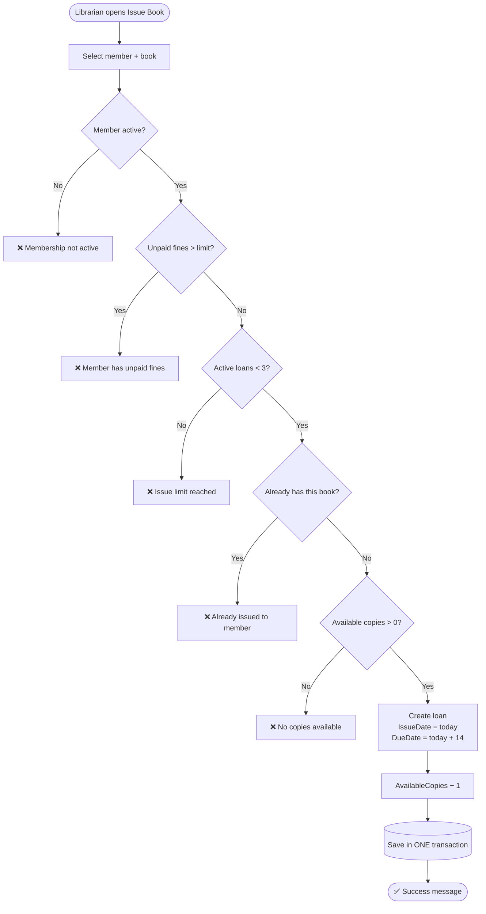

### 🔄 Workflow B: Return a Book

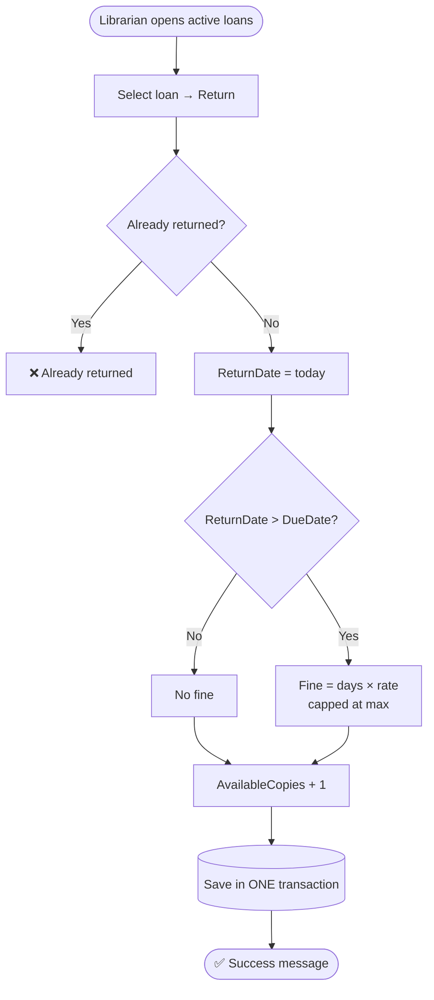

> [!IMPORTANT]
> **"Save in ONE transaction"**: creating the loan and decreasing the copy count must succeed **together** or fail **together**. If the loan is saved but the count is not updated, your inventory is corrupted. You will implement this in the Business Logic module.

---

## 2.10 Edge Cases 💥🎯

| # | Edge case | Expected behavior |
|---|---|---|
| E-01 | Two librarians issue the **last copy** at the same second | Only one succeeds; the other sees *"No copies available"* (concurrency control) |
| E-02 | Returning an already-returned book | Rejected with a clear message |
| E-03 | Adding a book with a duplicate ISBN | Rejected: *"A book with this ISBN already exists"* |
| E-04 | Reducing total copies below the number currently issued | Rejected |
| E-05 | Deleting an author linked to books | Rejected (BR-11), or soft delete |
| E-06 | A member account is deactivated while holding books | Loans stay valid; returns still allowed; new issues blocked |
| E-07 | A book is returned on the due date itself | No fine (0 days overdue) |
| E-08 | Search with empty text | Show all books, paginated |
| E-09 | A user changes the URL to view another member's loans (`/Loans/Member/25`) | Server blocks it: **403 Forbidden** |
| E-10 | A form is submitted twice (double-click) | No duplicate loan (handled by validation and the transaction) |
| E-11 | Clock and time-zone issues near midnight | Use UTC consistently |

> [!CAUTION]
> **E-09 is a real security bug category called IDOR** (Insecure Direct Object Reference). Hiding a button in the UI is **not** security. The **server** must check that the record belongs to the logged-in user.

---

# PART 3 — Initial Technical Decisions

## 3.1 High-Level Architecture (Stage 1)

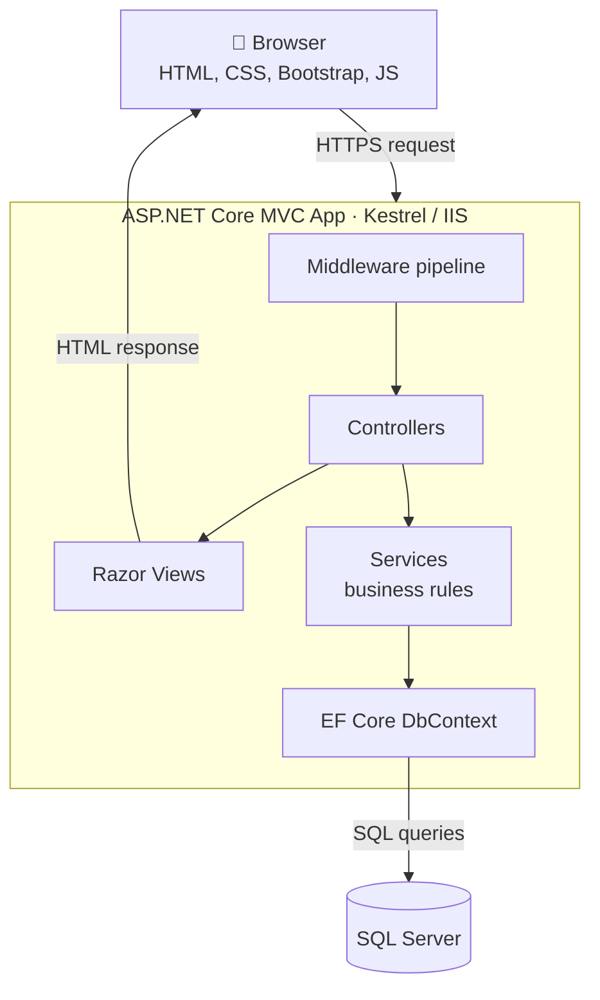

## 3.2 MVC Request Lifecycle 🔥🎯

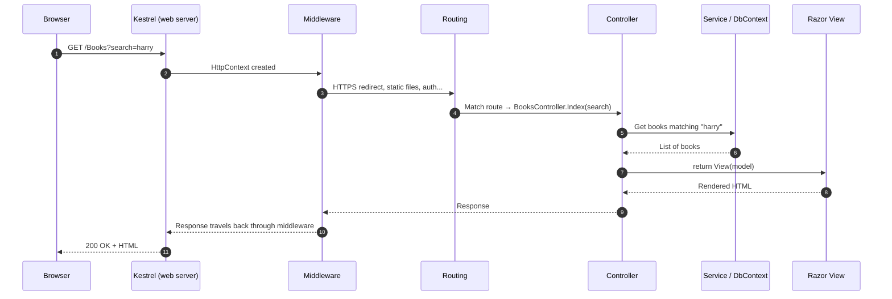

## 3.3 Why These Technologies? (and alternatives)

| Decision | Chosen | Why | Alternatives | Trade-off |
|---|---|---|---|---|
| Framework | **ASP.NET Core MVC** | Server-rendered pages, built-in security (anti-forgery, Identity), simple to deploy, great for learning fundamentals | Razor Pages, Blazor, Web API + SPA | Razor Pages is simpler for page-focused apps; MVC teaches the controller concepts reused in Web API (Stage 3) |
| Runtime | **.NET 10 LTS** | Long-Term Support until **November 2028**; stable for production | .NET 11 (STS) | STS gets newer features but has a shorter support window |
| Database | **SQL Server** | Relational data with strong relationships, transactions, first-class EF Core support, common in enterprise jobs | PostgreSQL, MySQL, SQLite | PostgreSQL is free and excellent; SQL Server dominates Microsoft-stack jobs |
| ORM | **EF Core** | LINQ queries, migrations, change tracking, reduces boilerplate SQL | Dapper, ADO.NET | Dapper is faster for raw reads but requires hand-written SQL and has no migrations |
| Auth | **ASP.NET Core Identity** | Password hashing, lockout, roles, claims built in | Custom auth, external IdP (Entra ID, Auth0) | Never write your own password hashing; external IdPs are better for enterprise SSO |

> [!NOTE]
> **LTS vs STS.** Even-numbered .NET versions (8, 10, 12…) are **LTS**: supported for 3 years. Odd-numbered versions (9, 11…) are **STS**: supported for 2 years. Production teams usually prefer LTS.

## 3.4 First Draft of the Database Design (ER Diagram)

> [!NOTE]
> This is a **first draft**. We will refine every column, data type, index and constraint in the EF Core & Database module. The goal now is to see the **relationships**.

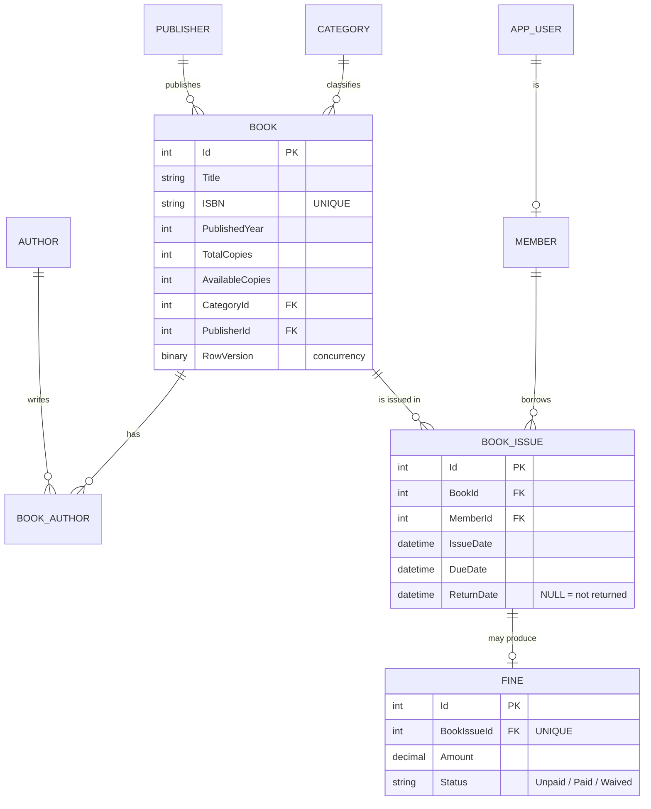

**Relationship types you can see in the diagram:** 🎯

| Type | Example | How it is stored |
|---|---|---|
| **One-to-many** | One Category → many Books | `CategoryId` foreign key in `Book` |
| **Many-to-many** | Books ↔ Authors (a book can have 2 authors; an author writes many books) | Join table `BookAuthor (BookId, AuthorId)` |
| **One-to-zero-or-one** | One BookIssue → at most one Fine | `BookIssueId` FK with a **UNIQUE** index in `Fine` |
| **One-to-one** | Identity user ↔ Member profile | `UserId` FK with a UNIQUE index in `Member` |

> [!TIP]
> **Design decision preview: copy counter vs. copy table.** We use `TotalCopies` and `AvailableCopies` on `Book` (simple). The alternative is a `BookCopy` table with one row per physical copy (with a barcode and condition). That is more realistic for big libraries but more complex. We start simple and protect the counter with `RowVersion` (optimistic concurrency) to solve edge case **E-01**.

## 3.5 Strategies (decided now, implemented later)

| Strategy | Decision |
|---|---|
| ✔️ **Validation** | Data annotations and ViewModels for input shape; service-level checks for business rules; database constraints as the final safety net. **Always validate on the server.** |
| ⚠️ **Exceptions** | Expected business failures (e.g., "no copies") → friendly message, not an exception page. Unexpected errors → global exception handler, logged with `ILogger`, generic error page. |
| 🔐 **Authentication** | ASP.NET Core Identity with cookie authentication. |
| 🛡️ **Authorization** | Role-based (`[Authorize(Roles = "Librarian,Administrator")]`), plus ownership checks for member data (prevents IDOR). |

---

# PART 4 — Install the Development Environment

> [!NOTE]
> Versions current as of November 2026: **.NET 10 LTS**, **Visual Studio 2026**, **SQL Server 2025**, **SSMS 22**. If a newer minor version is offered, take it. Keep the **major** version consistent across the team.

## 4.1 Install the .NET 10 SDK

**SDK vs Runtime** 🎯
- **SDK** (Software Development Kit) = tools to **build** apps (compiler, `dotnet` CLI, templates). Developers need this.
- **Runtime** = what is needed to **run** apps. Servers need this (for IIS: the **ASP.NET Core Hosting Bundle**).

🖱️ **GUI**
1. Go to **https://dotnet.microsoft.com/download**
2. Choose **.NET 10.0 (LTS)** → **SDK** → **Windows x64 installer**
3. Run the installer → **Install** → **Close**

> [!TIP]
> Visual Studio 2026 installs the .NET 10 SDK automatically with the web workload. A separate install is still useful if you also want to use VS Code or the CLI only.

⌨️ **CLI** (PowerShell or Windows Terminal)

```powershell
winget install Microsoft.DotNet.SDK.10
```

✅ **Verify** (open a **new** terminal window so the PATH refreshes):

```powershell
dotnet --version        # shows the SDK version in use, e.g. 10.0.xxx
dotnet --list-sdks      # all installed SDKs
dotnet --info           # full details: SDKs, runtimes, OS
```

> [!WARNING]
> **`'dotnet' is not recognized…`** means the terminal was opened **before** installation. Close it and open a new one. If it still fails, check that `C:\Program Files\dotnet\` is in your system PATH.

## 4.2 Install Visual Studio 2026

🖱️ **GUI**
1. Go to **https://visualstudio.microsoft.com** → download **Visual Studio 2026 Community** (free for learning and individuals)
2. In the installer, under **Workloads**, tick:
   - ✅ **ASP.NET and web development** 🔥 *(required)*
   - ✅ **Data storage and processing** *(optional: SQL tools, includes LocalDB)*
3. Click **Install** and wait
4. Sign in with a Microsoft account (optional, but it syncs settings)

⌨️ **CLI**

```powershell
winget search "Visual Studio Community"     # find the exact 2026 package ID
winget install --id <ID-from-search> -e
# Afterwards open "Visual Studio Installer" to add the ASP.NET workload
```

> [!TIP]
> **Prefer VS Code?** Install VS Code and the **C# Dev Kit** extension. All CLI commands in this guide work the same. This guide shows Visual Studio as the main GUI because the roadmap uses it.

## 4.3 Install SQL Server 2025

**Which edition?** 🎯

| Edition | Cost | Use for | Notes |
|---|---|---|---|
| **Developer** (Enterprise or Standard Developer) | Free | ✅ **Development & learning** (our choice) | Full features; **not licensed for production** |
| **Express** | Free | Small production apps | Up to 50 GB per database in SQL Server 2025 |
| **LocalDB** | Free | Quick local development | Comes with Visual Studio; starts on demand; no service to manage |
| Standard / Enterprise | Paid | Production | — |

🖱️ **GUI**
1. Go to **https://www.microsoft.com/sql-server** → **Download** → **Developer** edition
2. Run the installer → choose **Basic** (easiest) *or* **Custom** (to learn the options)
3. When it finishes, note the **instance name** and **connection string** on the final screen. The default instance is `localhost` or `.`; a named instance looks like `localhost\SQLEXPRESS`.

⌨️ **CLI** — the edition you need can vary by winget package, so search first:

```powershell
winget search "SQL Server 2025"
```

> [!TIP]
> **Fastest way to start:** LocalDB is already installed with Visual Studio. Its server name is `(localdb)\MSSQLLocalDB`. You can switch to full SQL Server later by changing only the connection string, which shows why the connection string lives in configuration.

```powershell
sqllocaldb info                # list LocalDB instances
sqllocaldb start MSSQLLocalDB  # start the default instance
```

## 4.4 Install SQL Server Management Studio (SSMS) 22

🖱️ **GUI**: go to **https://aka.ms/ssms** → download **SSMS 22** → install.

⌨️ **CLI**:

```powershell
winget search "SQL Server Management Studio"
winget install --id <ID-from-search> -e
```

✅ **Verify:** open SSMS → **Connect** → Server name `.` (or `(localdb)\MSSQLLocalDB`) → Authentication **Windows Authentication** → tick **Trust server certificate** → **Connect**. You should see the **Databases** folder in Object Explorer.

> [!WARNING]
> **Error "The certificate chain was issued by an authority that is not trusted"**: newer SQL clients encrypt connections by default. For **local development only**, tick *Trust server certificate*, or add `TrustServerCertificate=True` to the connection string. 🔴 In production, use a proper certificate instead.

## 4.5 Install Git

🖱️ **GUI**: **https://git-scm.com** → Download for Windows → install with the defaults.

⌨️ **CLI**:

```powershell
winget install Git.Git
```

**One-time setup** 🔥 (your name appears in every commit):

```powershell
git --version
git config --global user.name  "Your Name"
git config --global user.email "you@example.com"
git config --global init.defaultBranch main
```

## ✅ Environment Checklist

```powershell
dotnet --list-sdks     # contains 10.0.x
git --version          # git version 2.x
sqllocaldb info        # MSSQLLocalDB (if using LocalDB)
```

- [ ] Visual Studio 2026 opens and shows **ASP.NET Core** templates
- [ ] SSMS connects to your SQL Server or LocalDB instance

---

# PART 5 — Create the Solution (GUI ✚ CLI)

## 5.1 Solution vs Project 🎯

| Term | What it is | File |
|---|---|---|
| **Solution** | A container that groups related projects | `.slnx` (new XML format) or `.sln` (classic) |
| **Project** | One buildable unit: a web app, class library or test project | `.csproj` |

Right now we have **one** project. In Stage 2 we will add Domain, Application, Infrastructure and Tests projects to the **same solution**. That is why we create a solution from day one.

**Target folder layout:**

```text
LibraryManagement/                 ← Git repository root
├── LibraryManagement.slnx         ← solution file
├── .gitignore
└── src/
    └── LibraryManagement.Web/     ← our MVC project
        └── LibraryManagement.Web.csproj
```

## 5.2 🖱️ Option A: Visual Studio 2026 (GUI)

1. Open Visual Studio → **Create a new project**
2. Search **"mvc"** → choose **ASP.NET Core Web App (Model-View-Controller)** with the **C#** tag → **Next**
   > [!WARNING]
   > Do **not** choose *"ASP.NET Web Application (.NET Framework)"*. That is the old, Windows-only framework.
3. **Configure your new project:**
   - Project name: `LibraryManagement.Web`
   - Location: e.g. `C:\Projects\LibraryManagement\src`
   - Solution name: `LibraryManagement`
   - ☐ *Place solution and project in the same directory*: **leave unticked**
4. **Additional information:**

   | Option | Value | Why |
   |---|---|---|
   | Framework | **.NET 10.0 (Long Term Support)** | Our chosen LTS version |
   | Authentication type | **None** | We will add Identity **ourselves** in the Authentication module so you understand every piece |
   | Configure for HTTPS | ✅ | Secure by default; matches production |
   | Enable container support | ☐ | Not needed yet |
   | Do not use top-level statements | ☐ | Keep the modern, short `Program.cs` |

5. Click **Create**
6. Press **Ctrl+F5** to run without debugging. The browser opens the welcome page. 🎉

## 5.3 ⌨️ Option B: .NET CLI

> [!TIP]
> Do this at least once **even if you use Visual Studio**. CI/CD pipelines, Docker builds and Linux servers all use the CLI. Interviewers often ask *"How do you create and run a project without Visual Studio?"*

✍️ **TYPE IT** — run each command one at a time and read the output:

```powershell
# 1. Create and enter the root folder
mkdir C:\Projects\LibraryManagement
cd C:\Projects\LibraryManagement

# 2. Create an empty solution
dotnet new sln -n LibraryManagement

# 3. Create the MVC project inside src/
dotnet new mvc -n LibraryManagement.Web -o src/LibraryManagement.Web -f net10.0

# 4. Add the project to the solution
dotnet sln add src/LibraryManagement.Web/LibraryManagement.Web.csproj

# 5. Add a .gitignore made for .NET
dotnet new gitignore

# 6. Build and run
dotnet build
dotnet run --project src/LibraryManagement.Web
```

**What each command does:**

| Command | Meaning |
|---|---|
| `dotnet new sln -n X` | Create a solution named X. With the .NET 10 SDK the default format is **`.slnx`**. Add `--format sln` if you need the classic format for older tools. |
| `dotnet new mvc` | Use the **MVC template** (others: `webapi`, `razor`, `classlib`, `xunit`…) |
| `-n` | Name of the project (also its root namespace) |
| `-o` | Output folder |
| `-f net10.0` | Target framework moniker (TFM) |
| `dotnet sln add` | Register the project in the solution |
| `dotnet build` | Restore NuGet packages and compile |
| `dotnet run --project` | Build and start the web app |

🤔 **PREDICT:** after `dotnet run`, what URL will the terminal print? *(Answer: something like `https://localhost:7xxx` and `http://localhost:5xxx`. The ports come from `Properties/launchSettings.json`.)*

**Most-used CLI commands** 🔥

```powershell
dotnet new list            # list all templates
dotnet restore             # download NuGet packages
dotnet build               # compile
dotnet run                 # build + run
dotnet watch               # run + auto-reload on file save (Hot Reload)
dotnet test                # run tests (later)
dotnet add package <Name>  # add a NuGet package (later: EF Core)
dotnet publish -c Release  # create deployable output (deployment module)
dotnet dev-certs https --trust   # trust the local HTTPS certificate
```

> [!WARNING]
> **Browser says "Your connection is not private"** on `https://localhost`: run `dotnet dev-certs https --trust` once and click **Yes**. Visual Studio usually asks you to do this on the first run.

---

# PART 6 — Understand the Project Structure

```text
LibraryManagement.Web/
├── 📁 Properties/
│   └── launchSettings.json        ← how to start the app LOCALLY (ports, environment)
├── 📁 wwwroot/                    ← public static files (CSS, JS, images, Bootstrap)
├── 📁 Controllers/
│   └── HomeController.cs          ← handles requests
├── 📁 Models/
│   └── ErrorViewModel.cs          ← data passed to views
├── 📁 Views/
│   ├── Home/Index.cshtml          ← page for HomeController.Index()
│   ├── Shared/_Layout.cshtml      ← master page (header, nav, footer)
│   ├── Shared/Error.cshtml
│   ├── _ViewImports.cshtml        ← shared @using and Tag Helpers for all views
│   └── _ViewStart.cshtml          ← sets the default layout for all views
├── appsettings.json               ← configuration (all environments)
├── appsettings.Development.json   ← overrides for Development only
├── Program.cs                     ← 🔥 app entry point: services + pipeline
└── LibraryManagement.Web.csproj   ← project file: framework, packages, settings
```

| File / Folder | Why it exists | 🔥 Daily use? |
|---|---|:---:|
| `Program.cs` | Starts the app, registers services (DI), builds the middleware pipeline | 🔥🔥🔥 |
| `Controllers/` | Classes that receive requests and decide the response | 🔥🔥🔥 |
| `Views/` | Razor templates (HTML + C#) that render the UI | 🔥🔥🔥 |
| `Models/` | Classes that carry data | 🔥🔥 |
| `wwwroot/` | The **only** folder whose files are served directly to browsers | 🔥 |
| `appsettings.json` | Settings such as connection strings, logging and business-rule values | 🔥🔥 |
| `launchSettings.json` | **Local development only**: ports and environment name. **Not used in production.** | 🔥 |
| `.csproj` | Target framework, NuGet packages, compiler options | 🔥 |

## 6.1 The `.csproj` file

Open it with **double-click on the project** in Solution Explorer (GUI) or any editor (CLI).

```xml
<Project Sdk="Microsoft.NET.Sdk.Web">

  <PropertyGroup>
    <TargetFramework>net10.0</TargetFramework>
    <Nullable>enable</Nullable>
    <ImplicitUsings>enable</ImplicitUsings>
  </PropertyGroup>

</Project>
```

| Line | Meaning | What if removed or changed? |
|---|---|---|
| `Sdk="Microsoft.NET.Sdk.Web"` | Use the **Web SDK**: adds the ASP.NET Core framework reference and web publishing support | Using `Microsoft.NET.Sdk` → `WebApplication` and MVC types are not found |
| `<TargetFramework>net10.0` | Compile for .NET 10 | `net8.0` → builds for .NET 8 (the 8.0 targeting pack must be available) |
| `<Nullable>enable` | Nullable reference types: the compiler **warns** when something might be `null` | Fewer warnings, but more `NullReferenceException`s at runtime |
| `<ImplicitUsings>enable` | Adds common `using` lines automatically (`System`, `System.Linq`, `Microsoft.AspNetCore.Builder`…) | You must type those `using` lines in every file |

## 6.2 `Program.cs`, line by line 🔥🎯

Open `Program.cs`. Your template should look like this (small differences between SDK versions are normal):

```csharp
var builder = WebApplication.CreateBuilder(args);

// Add services to the container.
builder.Services.AddControllersWithViews();

var app = builder.Build();

// Configure the HTTP request pipeline.
if (!app.Environment.IsDevelopment())
{
    app.UseExceptionHandler("/Home/Error");
    app.UseHsts();
}

app.UseHttpsRedirection();
app.UseRouting();

app.UseAuthorization();

app.MapStaticAssets();

app.MapControllerRoute(
    name: "default",
    pattern: "{controller=Home}/{action=Index}/{id?}")
    .WithStaticAssets();

app.Run();
```

> [!IMPORTANT]
> **`Program.cs` has two halves. Memorize this:**
>
> 1. **Before `builder.Build()`** → **register services** (what the app *has*: DI container).
> 2. **After `builder.Build()`** → **configure the middleware pipeline** (what happens to *each request*, in order).

### 🧩 Line-by-line explanation

**① `var builder = WebApplication.CreateBuilder(args);`**
- Creates a **builder** pre-configured with sensible defaults:
  - **Configuration** from `appsettings.json`, `appsettings.{Environment}.json`, user secrets (in Development), environment variables and command-line `args`
  - **Logging** to the console and debug output
  - The **Kestrel** web server
  - The **DI container** (`builder.Services`)
- `args` = command-line arguments, e.g. `dotnet run --urls=http://localhost:6000`.
- `var` = the compiler infers the type (`WebApplicationBuilder`).

**② `builder.Services.AddControllersWithViews();`** 🔥
- Registers everything MVC needs: controller discovery, model binding, validation, the Razor view engine and Tag Helpers.
- ❌ **If removed:** the app crashes at startup or the first request with an error about required MVC services not being registered.
- Alternatives: `AddControllers()` (API only, no views, used in Stage 3) and `AddRazorPages()`.

**③ `var app = builder.Build();`**
- Locks the service registrations and creates the `WebApplication`.
- ⚠️ After this line you **cannot** add services anymore.

**④ `if (!app.Environment.IsDevelopment())`**
- The environment comes from the `ASPNETCORE_ENVIRONMENT` variable (`Development`, `Staging`, `Production`). The **default is `Production`** if it is not set. 🎯
- In Development you get the detailed **Developer Exception Page** automatically (stack traces). In Production you must **never** show stack traces to users.

**⑤ `app.UseExceptionHandler("/Home/Error");`**
- Catches unhandled exceptions and **re-executes** the request at `/Home/Error` to show a friendly page.
- It is placed **first** so it can catch errors from **all** middleware after it.

**⑥ `app.UseHsts();`** 🔐
- Sends the `Strict-Transport-Security` header: *"Browser, only use HTTPS for this site from now on."*
- Not used in Development because it would be cached by your browser for `localhost`.

**⑦ `app.UseHttpsRedirection();`**
- Redirects `http://` requests to `https://`.

**⑧ `app.UseRouting();`**
- **Matches** the incoming URL to an endpoint (a controller action), but does **not** run it yet.
- 🎯 Interview detail: with `WebApplication`, routing is added automatically if you don't call it. Calling it explicitly controls **where** in the pipeline matching happens, which matters because `UseAuthentication` and `UseAuthorization` must come **after** it.

**⑨ `app.UseAuthorization();`**
- Checks `[Authorize]` attributes on the matched endpoint. It has nothing to enforce yet; it becomes important in the Identity module, where we will add `app.UseAuthentication()` **just before** it.

**⑩ `app.MapStaticAssets();`**
- Serves files from `wwwroot` (CSS, JS, images) with build-time optimizations: compression and fingerprinted URLs for long caching.
- Older projects use `app.UseStaticFiles()`, which is still needed for files added at **runtime** (e.g., uploaded book covers).

**⑪ `app.MapControllerRoute(...)`** 🔥🎯
- Defines **conventional routing**: `{controller=Home}/{action=Index}/{id?}`

| URL | Controller | Action | id |
|---|---|---|---|
| `/` | Home *(default)* | Index *(default)* | — |
| `/Books` | BooksController | Index *(default)* | — |
| `/Books/Details/5` | BooksController | Details | 5 |
| `/Books/Edit/5` | BooksController | Edit | 5 |

- `=Home` / `=Index` = default values · `?` = optional segment.
- `.WithStaticAssets()` = lets views generate the optimized, fingerprinted static asset URLs.

**⑫ `app.Run();`**
- Starts Kestrel and **blocks**, listening for requests until the app stops.

### 🔄 The middleware pipeline visualized

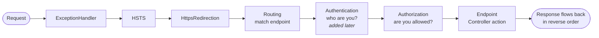

> [!CAUTION]
> 🎯 **Middleware ORDER matters.** If `UseAuthorization()` is placed **before** `UseRouting()`, authorization does not know which endpoint (and which `[Authorize]` attribute) applies. Authentication must also run **before** authorization, because you cannot decide what someone may do before you know who they are.

## 6.3 `appsettings.json` and environments 🔥🎯

```json
{
  "Logging": {
    "LogLevel": {
      "Default": "Information",
      "Microsoft.AspNetCore": "Warning"
    }
  },
  "AllowedHosts": "*"
}
```

| Key | Meaning |
|---|---|
| `Logging:LogLevel:Default` | Log `Information` and above (Information, Warning, Error, Critical) |
| `Microsoft.AspNetCore: Warning` | Framework logs only from Warning upwards, to reduce noise |
| `AllowedHosts` | Host header filtering; `*` = any. In production, set your real domain. |

**Configuration sources — later sources override earlier ones:** 🎯

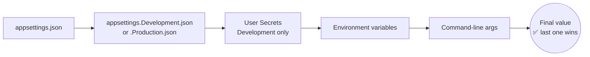

> [!CAUTION]
> 🔴 **Never commit real passwords or production connection strings to `appsettings.json`.** Use **User Secrets** locally (`dotnet user-secrets`) and environment variables or a secrets vault in production. We will practice this when we add the database connection string.

## 6.4 `launchSettings.json` (local only)

```json
"https": {
  "commandName": "Project",
  "launchBrowser": true,
  "applicationUrl": "https://localhost:7123;http://localhost:5123",
  "environmentVariables": {
    "ASPNETCORE_ENVIRONMENT": "Development"
  }
}
```

- `applicationUrl` → the ports Kestrel listens on locally.
- `ASPNETCORE_ENVIRONMENT=Development` → this is **why** you see detailed errors locally.

> [!WARNING]
> 🎯 **Classic trap:** *"I set the environment in launchSettings.json but production still behaves differently."* `launchSettings.json` is used **only** by Visual Studio and `dotnet run` on your machine. It is **not published**. On IIS you set the environment in `web.config` or in the server's environment variables.

## 6.5 Views: `_Layout`, `_ViewStart`, `_ViewImports`

| File | Role | Analogy |
|---|---|---|
| `_Layout.cshtml` | Shared page shell: `<head>`, navbar, footer. `@RenderBody()` marks where each page's content goes. | Picture frame |
| `_ViewStart.cshtml` | Runs before every view; sets `Layout = "_Layout";` | "Use this frame by default" |
| `_ViewImports.cshtml` | Shared `@using` directives and `@addTagHelper` for all views | Global imports |

---

# PART 7 — Run & Debug the First Application

## 7.1 Running

| Action | 🖱️ GUI (Visual Studio) | ⌨️ CLI |
|---|---|---|
| Run **with** debugger | **F5** | `dotnet run` (then attach a debugger) |
| Run **without** debugger (faster) | **Ctrl+F5** | `dotnet run` |
| Auto-reload on save | 🔥 Hot Reload button / save file | `dotnet watch` |
| Stop | **Shift+F5** | **Ctrl+C** |

## 7.2 Debugging basics 🔥

1. Open `Controllers/HomeController.cs`
2. Click in the **left margin** next to `return View();` inside `Index()` → a 🔴 red dot = **breakpoint**
3. Press **F5** → the browser opens → Visual Studio **pauses** on the breakpoint
4. Try these:

| Key | Action |
|---|---|
| **F10** | Step **over** (run the line, don't enter methods) |
| **F11** | Step **into** the method on this line |
| **Shift+F11** | Step **out** of the current method |
| **F5** | Continue to the next breakpoint |
| Hover a variable | See its value |
| **Locals / Watch** windows | Inspect all variables |

🤔 **PREDICT:** if you refresh the browser while paused, what happens? *(The browser keeps loading because the server thread is paused at your breakpoint.)*

---

# PART 8 — Your First Real Code: Business Rules from Configuration

### 8.1 What are we building?

The home page will display the library's name and its borrowing rules (**BR-01 to BR-05**), read from `appsettings.json`, **not hard-coded**.

### 8.2 Why?

- It implements **NFR-07** (configurable rules).
- It teaches three core concepts that you will use in **every** later module: **configuration**, the **Options pattern** and **Dependency Injection**.

### 8.3 The concept in simple English

- **Configuration** = settings stored outside the code.
- **Options pattern** = bind a configuration **section** to a **C# class**, so you get type-safe properties (`settings.LoanPeriodDays`) instead of strings (`config["Library:LoanPeriodDays"]`).
- **Dependency Injection (DI)** = classes don't create what they need; they **ask for it in their constructor**, and the framework **provides** it.

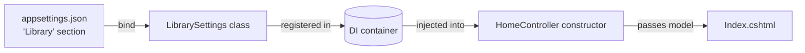

### 8.4 Step 1 — Add the settings ✍️ TYPE IT

Open `appsettings.json` and **add** the `Library` section:

```diff
 {
   "Logging": {
     "LogLevel": {
       "Default": "Information",
       "Microsoft.AspNetCore": "Warning"
     }
   },
-  "AllowedHosts": "*"
+  "AllowedHosts": "*",
+  "Library": {
+    "Name": "City Central Library",
+    "MaxActiveLoansPerMember": 3,
+    "LoanPeriodDays": 14,
+    "FinePerDay": 1.00,
+    "MaxFinePerLoan": 50.00,
+    "MaxUnpaidFinesToBorrow": 10.00
+  }
 }
```

> [!WARNING]
> JSON gotchas: add the **comma** after `"*"`; **no** comma after the last property; and JSON does not allow comments.

### 8.5 Step 2 — Create the settings class ✍️ TYPE IT

🖱️ **GUI:** right-click the project → **Add** → **New Folder** → `Configuration` → right-click the folder → **Add** → **Class…** → `LibrarySettings.cs`
⌨️ **CLI:** create the folder `Configuration` and the file `LibrarySettings.cs` in your editor.

```csharp
using System.ComponentModel.DataAnnotations;

namespace LibraryManagement.Web.Configuration;

public sealed class LibrarySettings
{
    public const string SectionName = "Library";

    [Required]
    public string Name { get; init; } = string.Empty;

    [Range(1, 20)]
    public int MaxActiveLoansPerMember { get; init; }

    [Range(1, 90)]
    public int LoanPeriodDays { get; init; }

    [Range(0, 1000)]
    public decimal FinePerDay { get; init; }

    [Range(0, 100000)]
    public decimal MaxFinePerLoan { get; init; }

    [Range(0, 100000)]
    public decimal MaxUnpaidFinesToBorrow { get; init; }
}
```

**Line-by-line:**

| Code | Meaning | What if removed or changed? |
|---|---|---|
| `namespace LibraryManagement.Web.Configuration;` | **File-scoped namespace** (C# 10+): everything in this file belongs to this namespace, without extra braces | The class ends up in the global namespace, which is messy and can cause name clashes |
| `public` | Accessible from other classes (the Options system and the controller) | `internal` would still work inside this project; `private` is not allowed for a top-level class |
| `sealed` | Nobody can inherit from this class. It is a plain settings holder, so inheritance has no use, and `sealed` states that intent. | Works without it; `sealed` is a design signal |
| `const string SectionName = "Library"` | One place for the section name, so there are no "magic strings" scattered around | A typo like `"Libary"` elsewhere would silently bind **nothing** |
| `[Required]`, `[Range(1, 20)]` | **Data annotations** used to validate the settings at startup (Step 3) | A wrong config such as `LoanPeriodDays: 0` would be accepted silently |
| `{ get; init; }` | `init` = the value can be set **only while the object is created**, then it is read-only | With `set`, any code could change the policy at runtime by mistake |
| `= string.Empty;` | Default value; satisfies **nullable reference types** (no null warning) | Compiler warning *CS8618: non-nullable property must contain a non-null value* |
| `decimal` | Exact base-10 number: 🔥 **always use `decimal` for money** | `double` can produce rounding errors such as `0.1 + 0.2 = 0.30000000000000004` |

> [!IMPORTANT]
> 🎯 **INTERVIEW:** *"Why `decimal` and not `double` for fines?"* `double` is binary floating point and cannot represent many decimal fractions exactly. `decimal` is base-10 and exact for financial values. It is slower, which does not matter here.

### 8.6 Step 3 — Register it in `Program.cs` ✍️ TYPE IT

```diff
+using LibraryManagement.Web.Configuration;
+
 var builder = WebApplication.CreateBuilder(args);

 // Add services to the container.
 builder.Services.AddControllersWithViews();
+
+builder.Services
+    .AddOptions<LibrarySettings>()
+    .Bind(builder.Configuration.GetSection(LibrarySettings.SectionName))
+    .ValidateDataAnnotations()
+    .ValidateOnStart();

 var app = builder.Build();
```

| Call | What it does |
|---|---|
| `AddOptions<LibrarySettings>()` | Registers the Options infrastructure for this class in the DI container |
| `.Bind(builder.Configuration.GetSection(...))` | Copies JSON values into matching property names. Matching is **case-insensitive**. |
| `.ValidateDataAnnotations()` | Applies the `[Required]` and `[Range]` rules |
| `.ValidateOnStart()` | 🔥 Validates **when the app starts** instead of on first use, so bad configuration fails fast, during deployment, and not in front of a user |

> [!NOTE]
> **Why does this go *before* `builder.Build()`?** Because it is a **service registration**. Remember the two halves of `Program.cs`.

### 8.7 Step 4 — Inject it into the controller ✍️ TYPE IT

Open `Controllers/HomeController.cs`. Change **only** the parts shown (keep the `Privacy` and `Error` actions as they are):

```diff
 using System.Diagnostics;
+using LibraryManagement.Web.Configuration;
 using LibraryManagement.Web.Models;
 using Microsoft.AspNetCore.Mvc;
+using Microsoft.Extensions.Options;

 namespace LibraryManagement.Web.Controllers;

 public class HomeController : Controller
 {
+    private readonly LibrarySettings _settings;
+
+    public HomeController(IOptions<LibrarySettings> options)
+    {
+        _settings = options.Value;
+    }
+
     public IActionResult Index()
     {
-        return View();
+        return View(_settings);
     }
```

> [!NOTE]
> If your template's `HomeController` has an `ILogger<HomeController>` constructor, **add** the `IOptions<LibrarySettings> options` parameter to the existing constructor instead of creating a second one. A class must have only **one** constructor that DI can use.

| Code | Meaning |
|---|---|
| `: Controller` | Inherits from MVC's `Controller` base class, which gives `View()`, `RedirectToAction()`, `TempData`, `User`, and more |
| `private readonly LibrarySettings _settings;` | A field holding the settings. `readonly` = assigned only in the constructor. The `_` prefix is the standard .NET naming convention for private fields. |
| `HomeController(IOptions<LibrarySettings> options)` | 🔥 **Constructor injection**: MVC asks the DI container for `IOptions<LibrarySettings>` every time it creates this controller |
| `options.Value` | The actual bound `LibrarySettings` object |
| `return View(_settings);` | Renders `Views/Home/Index.cshtml` and passes the settings as its **model** |

**What happens internally at runtime:**

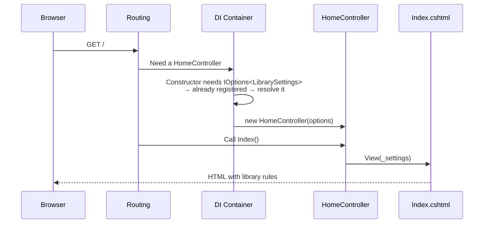

> [!TIP]
> 🎯 **Why not just `new LibrarySettings()` inside the controller?** Then the controller would decide where settings come from, which makes it hard to test and impossible to change without editing code. With DI, tests can pass in fake settings such as `Options.Create(new LibrarySettings { ... })`. This is the foundation of the **Dependency Inversion Principle** you will study in Stage 2.

### 8.8 Step 5 — Show it in the view ✍️ TYPE IT

Replace the content of `Views/Home/Index.cshtml`:

```cshtml
@model LibraryManagement.Web.Configuration.LibrarySettings

@{
    ViewData["Title"] = "Home";
}

<div class="text-center mb-4">
    <h1 class="display-5">Welcome to @Model.Name</h1>
    <p class="lead text-muted">Borrowing rules</p>
</div>

<div class="row justify-content-center">
    <div class="col-md-6">
        <ul class="list-group">
            <li class="list-group-item d-flex justify-content-between">
                Maximum books per member
                <span class="badge bg-primary">@Model.MaxActiveLoansPerMember</span>
            </li>
            <li class="list-group-item d-flex justify-content-between">
                Loan period
                <span class="badge bg-primary">@Model.LoanPeriodDays days</span>
            </li>
            <li class="list-group-item d-flex justify-content-between">
                Fine per overdue day
                <span class="badge bg-warning text-dark">@Model.FinePerDay.ToString("0.00")</span>
            </li>
            <li class="list-group-item d-flex justify-content-between">
                Maximum fine per loan
                <span class="badge bg-danger">@Model.MaxFinePerLoan.ToString("0.00")</span>
            </li>
        </ul>
    </div>
</div>
```

| Code | Meaning |
|---|---|
| `@model ...LibrarySettings` | Declares the view's **strongly typed model**. `Model` now has IntelliSense and compile-time checks. 🔥 |
| `@{ ViewData["Title"] = "Home"; }` | A C# code block; sets the browser tab title used by `_Layout.cshtml` |
| `@Model.Name` | Outputs the value **HTML-encoded** automatically. 🔐 This is Razor's built-in **XSS protection**. |
| `.ToString("0.00")` | Formats the money with 2 decimal places |
| `class="list-group …"` | Bootstrap CSS classes (Bootstrap is included by the template) |

> [!WARNING]
> **`@model` (lowercase) vs `Model` (uppercase)**: `@model` **declares** the type at the top of the file; `Model` **uses** the object. Mixing them up is a very common beginner error.

### 8.9 Step 6 — Run and verify ✅

```powershell
dotnet watch --project src/LibraryManagement.Web
```

**Expected output:** the home page shows *"Welcome to City Central Library"* and the four rules as colored badges.

🧪 **Experiments (do all four):**

| # | Change | 🤔 Predict, then check |
|---|---|---|
| 1 | In `appsettings.json` change `"LoanPeriodDays": 21`, refresh, then restart the app if needed | The page shows **21 days** with no code change (see the note in 8.11 for *when* it updates) |
| 2 | Set `"LoanPeriodDays": 0` and restart | The app **fails to start** with an `OptionsValidationException` (`ValidateOnStart` at work). Put it back to 14 afterwards. |
| 3 | Rename the section to `"Libary"` (typo) and restart | Startup fails: `Name` is required and nothing was bound. This is why we used `SectionName`. |
| 4 | Add `"Library": { "LoanPeriodDays": 7 }` to `appsettings.Development.json` | The page shows **7 days**: the environment file **overrides** the base file |

## 8.10 Common errors & debugging

| Error / symptom | Cause | Fix |
|---|---|---|
| `InvalidOperationException: Unable to resolve service for type 'IOptions<LibrarySettings>'…` | Registration missing in `Program.cs` | Add the `AddOptions<LibrarySettings>()…` lines |
| `NullReferenceException` in the view at `Model.Name` | `return View();` without passing the model | Use `return View(_settings);` |
| All values show 0 or are empty | Section or property names don't match the JSON | Check spelling, and use `LibrarySettings.SectionName` |
| `CS0246: The type or namespace 'LibrarySettings' could not be found` | Missing `using LibraryManagement.Web.Configuration;` | Add the `using`, or press **Ctrl+.** in Visual Studio for a quick fix |
| JSON parse error on startup | Missing or extra comma | Check line and column in the error message |
| Changes to a `.cs` file don't appear | Hot Reload could not apply the edit | Restart `dotnet watch` (press **Ctrl+R** in the terminal) or rebuild |

## 8.11 Alternatives & trade-offs 🎯

| Approach | Example | Verdict |
|---|---|---|
| Hard-coded constant | `const int MaxLoans = 3;` | ❌ Needs a code change and redeploy to change policy |
| `IConfiguration` directly | `config["Library:LoanPeriodDays"]` | ⚠️ Works, but uses strings, needs manual parsing and has no validation |
| **`IOptions<T>`** ✅ | Our choice | Typed and validated; read **once**; registered as a **singleton** |
| `IOptionsSnapshot<T>` | Same usage | **Scoped**: re-reads configuration on each request; cannot be injected into singletons |
| `IOptionsMonitor<T>` | `.CurrentValue`, `OnChange` | **Singleton** with change notifications; use it for live reloading in long-running services |
| Database settings table | `Settings` table | Admins can change rules from the UI; more work; possible future improvement |

> [!NOTE]
> 🤔 **About experiment #1:** `IOptions<T>` is a singleton, so a *running* app keeps the old value. If you saw 21 immediately, the app was **restarted** (for example by `dotnet watch`). If you saw 14 until you restarted, that is `IOptions<T>` behaving as designed. Try switching the controller to `IOptionsSnapshot<LibrarySettings>` under plain `dotnet run`: the new value appears on the **next request** without a restart.

## 8.12 Production improvements

- Keep the **policy values** (non-secret) in `appsettings.json`; keep **secrets** in User Secrets, environment variables or a vault.
- Later, move business rules into a **service** (e.g., `LoanPolicy`) so they can be unit tested. Controllers should not calculate fines.
- `ValidateOnStart()` makes a broken deployment fail immediately, so you notice it right away instead of when a user hits the page.

---

# PART 9 — Save Your Work with Git

🖱️ **GUI (Visual Studio 2026)**
1. Menu **Git** → **Create Git Repository…**
2. Choose **Local only** for now (we push to GitHub in the Git module), or **GitHub** if you are already signed in
3. Confirm that the `.gitignore` template is **Visual Studio** → **Create**
4. Open **View → Git Changes** → type a message → **Commit All**

⌨️ **CLI** — from the `LibraryManagement` root folder:

```powershell
git init
git status                       # 🤔 PREDICT: are bin/ and obj/ listed? (No, .gitignore hides them)
git add .
git commit -m "Step 1: requirements, MVC solution, library settings via Options pattern"
git log --oneline
```

> [!CAUTION]
> 🔴 **Always check `git status` before your first commit.** If you see `bin/`, `obj/` or `.vs/`, your `.gitignore` is missing. These are build outputs and editor files and must not be committed. Committing secrets is worse: removing them later does **not** remove them from the Git history.

> [!TIP]
> Also save Part 2 of this guide (Requirements) as `docs/Requirements.md` inside the repository. Real teams version their requirements next to their code.

---

# PART 10 — 🎯 Interview Preparation

## 🟢 10.1 Beginner Questions (10)

<details>
<summary><b>Q1. What is the difference between functional and non-functional requirements?</b></summary>

**Functional** requirements describe **what** the system does, e.g., *"A librarian can issue a book."* **Non-functional** requirements describe **how well** it does it: performance, security, reliability, usability, e.g., *"Search returns results in under 2 seconds."* An app can meet every functional requirement and still fail if it is slow or insecure.
</details>

<details>
<summary><b>Q2. What is a user story, and what are acceptance criteria?</b></summary>

A user story is a short requirement from the user's view: **"As a &lt;role&gt;, I want &lt;goal&gt;, so that &lt;benefit&gt;."** Acceptance criteria are testable conditions that define when the story is **done**, often written as **Given / When / Then**. Example: *Given a book with 0 copies, When I issue it, Then I see "No copies available".*
</details>

<details>
<summary><b>Q3. What is ASP.NET Core?</b></summary>

A free, open-source, cross-platform (Windows, Linux, macOS) framework from Microsoft for building web apps and APIs with C#. It includes a built-in DI container, a middleware pipeline, configuration and logging, and runs on the fast **Kestrel** web server.
</details>

<details>
<summary><b>Q4. What does MVC stand for, and what does each part do?</b></summary>

**Model**: the data and business state (e.g., `Book`). **View**: the UI that displays the data (`.cshtml`). **Controller**: receives the request, coordinates the work and chooses the view. It separates concerns, so UI changes don't break the business logic.
</details>

<details>
<summary><b>Q5. What is the .NET SDK versus the .NET runtime?</b></summary>

The **SDK** contains the tools to **develop**: compiler, `dotnet` CLI, templates. It also includes runtimes. The **runtime** only **runs** compiled apps. Developer machines need the SDK; servers need only the runtime (for IIS, the **ASP.NET Core Hosting Bundle**).
</details>

<details>
<summary><b>Q6. What is the purpose of `Program.cs`?</b></summary>

It is the entry point. It creates the builder, **registers services** in the DI container (before `Build()`), then **configures the middleware pipeline** and endpoints (after `Build()`), and finally starts the server with `app.Run()`.
</details>

<details>
<summary><b>Q7. What is `appsettings.json` used for?</b></summary>

Storing configuration outside the code: logging levels, connection strings, and business settings such as the loan period. Environment-specific files (`appsettings.Development.json`) override it. Secrets should not be stored there in plain text.
</details>

<details>
<summary><b>Q8. What is the `wwwroot` folder?</b></summary>

The web root: the only folder whose files (CSS, JS, images) are served directly to browsers as static files. Code files outside it (e.g., `Program.cs`) are never served.
</details>

<details>
<summary><b>Q9. What is LTS in .NET?</b></summary>

Long-Term Support: an even-numbered release (e.g., .NET 10) supported for **3 years** with security fixes. STS (odd-numbered) releases get 2 years. Production systems usually choose LTS for stability.
</details>

<details>
<summary><b>Q10. Why use `decimal` for money in C#?</b></summary>

`decimal` stores base-10 numbers exactly, so `0.1 + 0.2 == 0.3`. `double` and `float` are binary floating point and introduce small rounding errors, which are unacceptable for financial values such as fines.
</details>

## 🟡 10.2 Intermediate Questions (10)

<details>
<summary><b>Q1. What is middleware, and why does its order matter?</b></summary>

Middleware are components that form a pipeline. Each one can handle a request, modify it, short-circuit it, or pass it to the next one by calling `next()`. The response flows back through them in **reverse** order. Order matters because each middleware only sees what earlier ones allowed: the exception handler must be first to catch everything; routing must come before authentication and authorization so they know the endpoint; authentication must come before authorization.
</details>

<details>
<summary><b>Q2. Explain the ASP.NET Core configuration precedence.</b></summary>

With `WebApplication.CreateBuilder`, the default order is: `appsettings.json` → `appsettings.{Environment}.json` → User Secrets (Development only) → environment variables → command-line arguments. **Later sources override earlier ones** for the same key. That is how production overrides a local connection string without changing files.
</details>

<details>
<summary><b>Q3. How does ASP.NET Core determine the current environment?</b></summary>

From the `ASPNETCORE_ENVIRONMENT` variable (or `DOTNET_ENVIRONMENT`). If it is not set, it defaults to **Production**. Locally, `launchSettings.json` sets it to `Development`; on servers you set it in the environment variables or `web.config`.
</details>

<details>
<summary><b>Q4. What is the difference between `IOptions`, `IOptionsSnapshot` and `IOptionsMonitor`?</b></summary>

- `IOptions<T>`: **singleton**; the value is computed once and never refreshed.
- `IOptionsSnapshot<T>`: **scoped**; recomputed per request, so it picks up configuration changes. It cannot be injected into singletons.
- `IOptionsMonitor<T>`: **singleton**; gives `CurrentValue` and `OnChange` notifications. It suits singletons and background services that need live updates.
</details>

<details>
<summary><b>Q5. What is conventional routing versus attribute routing?</b></summary>

**Conventional** routing defines URL patterns centrally, e.g., `{controller=Home}/{action=Index}/{id?}` in `Program.cs`. **Attribute** routing puts routes on controllers and actions, e.g., `[Route("books/{id:int}")]`. MVC apps often use conventional routing; Web APIs normally use attribute routing (Stage 3).
</details>

<details>
<summary><b>Q6. What is Kestrel, and how does it relate to IIS?</b></summary>

Kestrel is ASP.NET Core's built-in, cross-platform web server. On Windows hosting, **IIS** commonly sits in front of it through the **ASP.NET Core Module**, either **in-process** (the app runs inside the IIS worker process, which is faster) or **out-of-process** (IIS acts as a reverse proxy to Kestrel). IIS adds process management, Windows authentication and centralized certificate handling.
</details>

<details>
<summary><b>Q7. What does `ValidateOnStart()` do, and why is it useful?</b></summary>

It forces options validation when the host **starts** instead of when the options are first used. A misconfigured deployment (e.g., `LoanPeriodDays: 0`) fails immediately and visibly, a principle called **fail fast**, instead of failing later for a real user.
</details>

<details>
<summary><b>Q8. What are nullable reference types?</b></summary>

A C# 8+ feature, enabled with `<Nullable>enable</Nullable>`. Reference types are treated as **non-null by default**, and you mark nullable ones with `?` (`string?`). The compiler warns when you might dereference null, catching `NullReferenceException`s at compile time. They are warnings, not runtime checks.
</details>

<details>
<summary><b>Q9. Why is `launchSettings.json` not used in production?</b></summary>

It is a **development-time** file read only by Visual Studio and `dotnet run`, and it is not included in published output. Production settings come from `appsettings.{Environment}.json`, environment variables, `web.config` or a secrets store.
</details>

<details>
<summary><b>Q10. What does `UseHsts()` do, and why is it not used in Development?</b></summary>

It sends the `Strict-Transport-Security` header, telling browsers to use only HTTPS for the domain for a set period, which protects against downgrade attacks. It is skipped in Development because browsers cache the rule, which could break other local HTTP sites on `localhost`.
</details>

## 🟣 10.3 Scenario-Based Questions (5)

<details>
<summary><b>S1. Two librarians try to issue the last copy of a book at the same time. What happens, and how would you prevent problems?</b></summary>

Without protection, both read `AvailableCopies = 1`, both save, and the count becomes −1 or two loans exist for one copy (a **race condition**). Solutions: **optimistic concurrency** (a `RowVersion` column: the second save fails with a concurrency exception and shows "No copies available"), an **atomic conditional update** (`UPDATE Books SET AvailableCopies = AvailableCopies - 1 WHERE Id = @id AND AvailableCopies > 0` and check the rows affected), plus a database **check constraint** `AvailableCopies >= 0` as the last line of defense. All of this runs inside one transaction with the loan insert.
</details>

<details>
<summary><b>S2. The library changes its policy from 3 to 5 books per member. What changes in your system?</b></summary>

Only the configuration value `MaxActiveLoansPerMember` in the environment's settings, with no code change, because the rule was made configurable (NFR-07) and read through the Options pattern. If admins should change it from the UI without a deployment, move it to a database settings table.
</details>

<details>
<summary><b>S3. A member changes the URL from /Loans/My to /Loans/Member/42 and sees another member's loans. What went wrong?</b></summary>

An **IDOR** vulnerability: the server trusted the ID from the URL without checking ownership. Fix: for Members, ignore the incoming ID and query by the **logged-in user's** member ID, or verify the record belongs to them and return **403/404** if not. Role checks alone are not enough; you need **resource-level authorization**.
</details>

<details>
<summary><b>S4. The app works locally but shows a generic error page in production with no detail. How do you investigate?</b></summary>

That is expected behavior: production uses `UseExceptionHandler` and hides stack traces. Check the **logs** (stdout logs via `web.config`, or a configured log provider), the Windows **Event Viewer** on IIS, and confirm the environment name and connection strings. Never switch production to Development to "see the error", because that exposes internals to users.
</details>

<details>
<summary><b>S5. The client asks for "book reservations" in the middle of the project. How do you handle it?</b></summary>

Check the **scope document**: reservations are listed as out of scope. Treat it as a **change request**: write a user story and acceptance criteria, estimate its impact (a new table, a new workflow, edge cases such as a reserved book being returned), and let the stakeholders prioritize it for a later sprint. Don't silently add it, because unplanned scope breaks timelines.
</details>

## 🔵 10.4 Practical Coding Questions (5)

**P1.** Add `"OpeningHours": "08:00 - 20:00"` to the `Library` section and display it on the home page. *(Tests: configuration binding and the view model.)*

**P2.** Write a static method that calculates a fine using the rules in this guide.

<details>
<summary>Show a sample answer (try first!)</summary>

```csharp
public static decimal CalculateFine(DateOnly dueDate, DateOnly returnDate,
                                    decimal finePerDay, decimal maxFine)
{
    int daysLate = returnDate.DayNumber - dueDate.DayNumber;
    if (daysLate <= 0) return 0m;              // on time or early → BR-14
    decimal fine = daysLate * finePerDay;      // BR-03
    return Math.Min(fine, maxFine);            // BR-04 cap
}
```

`DateOnly` avoids time-of-day bugs (11:59 PM vs 12:01 AM); `0m` is a `decimal` literal.
</details>

**P3.** Make the app listen on port 6000 using **only** the command line. *(Answer: `dotnet run --urls "http://localhost:6000"`.)*

**P4.** Add a custom middleware in `Program.cs` that logs how long each request takes.

<details>
<summary>Show a sample answer (try first!)</summary>

```csharp
app.Use(async (context, next) =>
{
    var sw = System.Diagnostics.Stopwatch.StartNew();
    await next(context);                       // run the rest of the pipeline
    sw.Stop();
    app.Logger.LogInformation("{Method} {Path} took {Ms} ms",
        context.Request.Method, context.Request.Path, sw.ElapsedMilliseconds);
});
```

The `{Method}`-style placeholders are **structured logging**: the values are stored as named fields, not just text.
</details>

**P5.** Move `"Name"` into `appsettings.Development.json` with the value `"DEV Library"` and confirm only Development shows it. Then run with the Production environment:

```powershell
dotnet run --environment Production
```

## ⚠️ 10.5 Common Interview Traps & Misconceptions

| ❌ Misconception | ✅ Reality |
|---|---|
| "Hiding a button prevents access" | Only **server-side** authorization protects data |
| "`launchSettings.json` configures production" | It is local-only and not published |
| "Default environment is Development" | The default is **Production** |
| "Middleware order doesn't matter" | It matters a lot: routing → authentication → authorization |
| "`double` is fine for money" | Use `decimal` |
| "Client-side validation is enough" | It can be bypassed (Postman, DevTools). **Always validate on the server.** |
| "ASP.NET Core = .NET Framework" | ASP.NET Core is cross-platform and modern; ASP.NET (.NET Framework) is Windows-only and in maintenance mode |
| "`IOptions<T>` reloads when the file changes" | It doesn't; use `IOptionsSnapshot` or `IOptionsMonitor` |
| "More requirements detail = waterfall" | Agile teams still write user stories and acceptance criteria, just in small pieces |

## 🔁 10.6 Follow-Up Questions an Interviewer May Ask

- *"You said routing must come before authorization. What happens if `UseAuthorization` is placed before `UseRouting`?"*
- *"How would you store the database password securely in production?"*
- *"If `IOptionsSnapshot` is scoped, what happens if you inject it into a singleton service?"* (Startup error in Development due to scope validation; a captured dependency otherwise.)
- *"How would you unit test `HomeController` without `appsettings.json`?"* (Pass `Options.Create(new LibrarySettings { ... })`.)
- *"Why not use the copy-table design (one row per physical copy) from the start?"*
- *"How do acceptance criteria relate to automated tests?"*

---

# 📝 EXERCISE — Do This Before Step 2

> [!IMPORTANT]
> **Complete all four tasks, then reply with your results** (screenshots, code, or errors). We move to Step 2 only after you confirm.

1. **Requirements:** write **one new user story** with **3 acceptance criteria** for *"Member views their unpaid fines"*.
2. **Business rule:** add one business rule of your own to the table in 2.7 (e.g., about membership expiry) and explain **why** it is needed.
3. **Code:** complete practical question **P1** (`OpeningHours`) by typing it yourself, and run experiments **1–4** from section 8.9.
4. **Git:** commit your changes with a meaningful message and send me the output of `git log --oneline`.

**Bonus 🏅:** implement **P4** (timing middleware). Move it to the **very top** and then to the **very bottom** of the pipeline (just before `app.Run()`). Explain the difference you observe.

---

## ✅ Step 1 Completion Checklist

- [ ] I can explain FR vs NFR with library examples
- [ ] I wrote user stories with Given/When/Then acceptance criteria
- [ ] I know all 14 business rules and why some are configurable
- [ ] I can draw the Issue Book workflow from memory
- [ ] .NET 10 SDK, Visual Studio 2026, SQL Server, SSMS 22 and Git are installed and verified
- [ ] I created the solution with **both** Visual Studio and the CLI
- [ ] I can explain every line of `Program.cs`, and why middleware order matters
- [ ] I implemented `LibrarySettings` with the Options pattern and DI
- [ ] I ran all 4 configuration experiments and understood the results
- [ ] My work is committed to Git
- [ ] I can answer the 10 beginner and 10 intermediate questions without looking

---

### ⏭️ Next: STEP 2 — C# Essentials for the Project & MVC Fundamentals

*(Controllers, actions, GET/POST, model binding, ViewModels, Tag Helpers, layouts and partial views, built on the **Category** module of our library.)*
